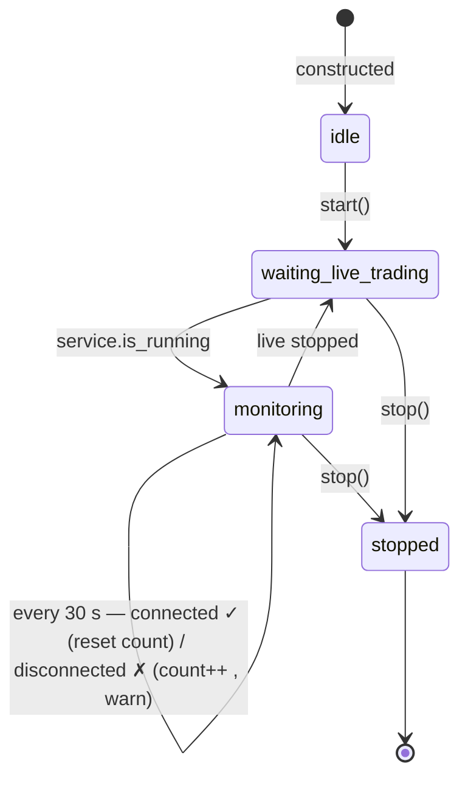

# ExecutorAgent

`src/agent/executor_agent.py` · one instance per logged-in Zerodha user · owned by `TradingServiceAgent` ([supervisor.py](../../src/agent/supervisor.py))

## Role

Despite the name, it **does not execute anything**. Orders are placed inside `TradingService`: ticks → `_on_ticks` → strategy signals → `ExecutionEngine.execute_signal`. This agent is a health monitor for that path. Every 30 s while live trading is on, it checks whether the Kite WebSocket ticker is connected, and logs a warning if not.

The docstring is explicit that it must not place orders itself, to avoid duplicate execution. That's the right call.

## Configuration

| Setting | Value | Where |
|---|---|---|
| Interval | 30 s | `DEFAULT_HEALTH_CHECK_INTERVAL_SECONDS` |
| Runs when | `service.is_running` | `_run_loop` |
| Checks | `service._ticker.is_connected` (a property: WebSocket open) | `_run_loop` |
| Broker API calls | none | |

## Lifecycle and states

## State it keeps

| Field | Meaning | Caveat |
|---|---|---|
| `ticker_connected` | result of the last check | |
| `stall_warnings` | consecutive disconnected checks | resets to 0 on the first connected check, so no outage history is kept |
| `last_checked_at` | last check time | only while live |
| `last_error` | exception text if the check itself failed | |

Exposed at `GET /api/agents/status` → `executor`. **Not shown anywhere in the dashboard.**

## Information flow

| Direction | What | How |
|---|---|---|
| reads | `service.is_running` | gate |
| reads | `service._ticker.is_connected` | private attribute, property |
| writes | its own counters | in memory |
| logs | `executor_agent_ticker_disconnected` with `consecutive=N` | every check while down |
| acts on | **nothing** | no reconnect, alert, kill switch or UI signal |

It receives nothing from the Scanner or Verifier and passes nothing to the Tracker.

## Observed behaviour (logs, 7 Aug – 16 Oct 2026)

- **967** disconnect warnings.
- Longest run: **910 consecutive checks ≈ 7.6 hours** with the ticker down while `is_running` was true.

For that whole period the strategies received no ticks, so they produced no signals and no tick-driven exits (trailing stops, target exits, strategy exit rules). Protective stop-losses that `ExecutionEngine` places at the broker when an order fills keep working, because they sit at the exchange. Live trading stayed "on", and the only trace was a log line every 30 s.

## Critical analysis

### E1 — Detects the outage, then does nothing (critical)

The scenario this agent exists for happened, and lasted most of a trading day. Nothing reconnected the ticker, flattened or protected positions, raised the kill switch, or told the user.

**Fix**, as escalation by duration:
1. **> 1 min:** try `ticker.connect()` again (with backoff).
2. **> 3 min:** show a red banner in the dashboard and send a push or notification.
3. **> N min with open positions:** hand over to a configured risk action, e.g. confirm every open position has its broker-side protective stop-loss (the engine places one on fill; positions opened manually may not have one), or activate the kill switch so no new entries happen on stale data.

### E2 — "Connected" isn't "healthy" (high)

A WebSocket can be open while no ticks arrive: the subscription was lost after a reconnect, the market is paused, or token mode is wrong. The agent would report healthy. It also doesn't look at the rest of the path it claims to supervise: signal generation, `ExecutionEngine` errors, rejected orders, reconciliation lag.

**Fix:** track `last_tick_at` (`TradingService._on_ticks` already sees every tick) and alert when no tick has arrived for X seconds during market hours. Add counters from `ExecutionEngine` for rejected or failed orders in the last N minutes.

### E3 — Invisible to the user (high)

Status is available over the API but never rendered. The 7.6-hour outage would have shown nothing on screen.

**Fix:** add a feed-health indicator to the terminal header (green when live and ticking, red when live and stale or disconnected), driven by `/api/agents/status`.

### E4 — No outage history (low)

`stall_warnings` resets on reconnect, so the status can't answer "how often did the feed drop today?".

**Fix:** keep a small ring buffer of `(down_at, up_at)` intervals.

### E5 — Misleading name (low)

"ExecutorAgent" suggests it places orders, which invites someone to make it do so and creates exactly the duplicate-execution risk the docstring warns about.

**Fix:** rename to `ExecutionHealthAgent` / `FeedWatchdogAgent` (and the `executor` key in the status API, with a compatibility alias).

## Recommended order of work

1. **E2:** add the tick-staleness signal.
2. **E3:** surface it in the header.
3. **E1:** escalation ladder, starting with reconnect plus alert before any automatic risk action.
