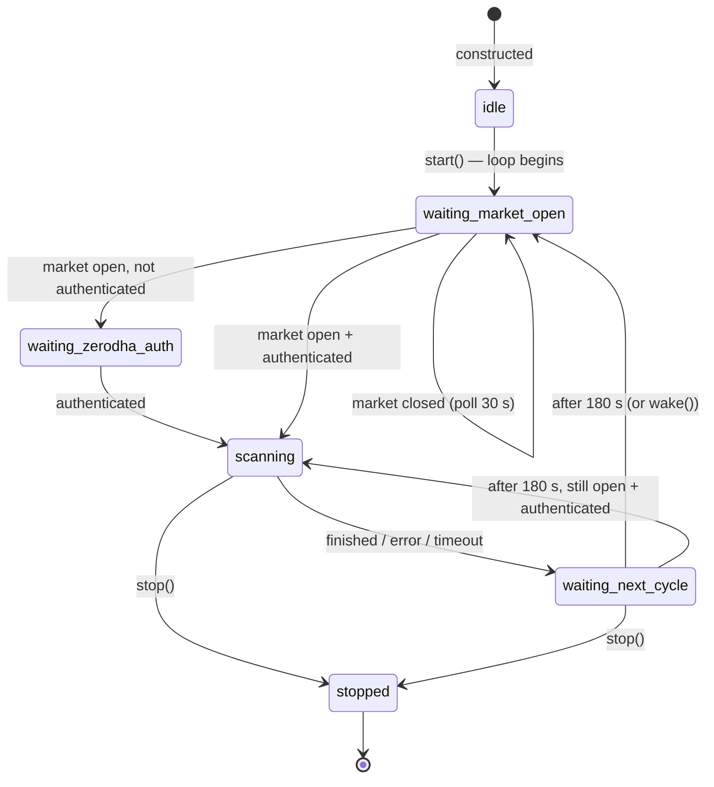

# ScannerAgent

`src/agent/scanner_agent.py` · one instance per logged-in Zerodha user · owned by `TradingServiceAgent` ([supervisor.py](../../src/agent/supervisor.py))

## Role

Re-runs the full technical-analysis scan (`TradingService.run_analysis_scan` → `StockScanner.run_scan`) on a timer during market hours, so the Analysis tab, sector breakdown and stock profiles stay fresh without anyone pressing **Run Full Scan**.

It produces no signals and places no orders. Its only output is the scanner's in-memory cache.

## Configuration

| Setting | Value | Where |
|---|---|---|
| Universe | `nifty500` (501 stocks) | constructor default, `scanner_agent.py:36` |
| Interval between scans | 180 s | `DEFAULT_SCAN_INTERVAL_SECONDS` |
| Poll while market closed / not logged in | 30 s | `IDLE_POLL_SECONDS` |
| Timeout per scan | 120 s | `SCAN_TIMEOUT_SECONDS` |
| Market hours | Mon–Fri 09:15–15:30 IST, no holiday calendar | `market_hours.py` |

None of these can be changed at runtime or through the API.

## Lifecycle and states

Started by `TradingServiceAgent.start_supervision()` the first time the user's `TradingService` is created (first authenticated request after a server start). Stopped only by `TradingServiceSupervisorAgent.remove_service()`, which is called only on app shutdown.

`wake()` cuts any wait short. The web app calls it after a Zerodha login (`webapp.py` lines ~310, 329, 358), so a scan starts right away instead of up to 30 s later.

## State it keeps

| Field | Meaning | Caveat |
|---|---|---|
| `_state` | current state above | logged only on change |
| `scan_count` | scans that returned without an `error` key | a cancelled (timed-out) scan is not counted, correctly |
| `last_scan_at` | time the last scan *returned* | set even when the result was an error, so it isn't "last successful scan" |
| `last_error` | last error text or timeout message | cleared by the next clean scan |

Exposed read-only at `GET /api/agents/status` → `scanner`. **The dashboard never displays it.**

## Information flow

| Direction | What | How |
|---|---|---|
| reads | wall clock (IST) | `is_market_open()` |
| reads | `service.is_authenticated` | property on the service |
| calls | `service.run_analysis_scan(universe="nifty500")` | wrapped in `asyncio.wait_for(…, 120)` |
| → Kite | NSE instrument dump (once), ~1 year of daily candles **per stock** (501 calls), quote batches of 50 (11 calls) | shared `KiteClient` rate limiters (historical: 3 req/s) |
| writes | `StockScanner._analysis_cache` (merged), `_universe_results["nifty500"]`, `_universe_reports["nifty500"]` | only once the *whole* scan finishes |
| broadcasts | `scan_progress` WebSocket message per stock to every connected browser | the UI ignores it unless the user started the scan |
| consumed by | Analysis tab, Sectors view, stock analysis popup, research endpoints | by reading the cache; nothing is notified |

It does **not** pass anything to the Verifier, Executor or Tracker, and none of them read the scan results.

## Observed behaviour (logs, 7 Aug – 16 Oct 2026)

- 161 scans started, **48 timed out** (30%) with the old 358-stock list.
- 5 scans aborted on authentication errors; 19 per-stock `scan_failed` events.

## Critical analysis

### S1 — Every scan now times out and its work is thrown away (critical)

A NIFTY 500 scan makes ~501 historical calls through a 3 req/s limiter: at least **167 s** before quotes and indicator maths. The agent cancels at **120 s**. `run_scan` builds its report only at the very end, so a cancelled scan writes nothing: the ~360 calls it made are wasted. With the old 358-stock list (~120 s minimum) this already failed 30% of the time. With 501 stocks it fails every time, so the agent never refreshes anything.

**Fix:** derive the timeout from the universe size (e.g. `len(symbols) / 3 + 60` s), or drop the hard timeout and use a progress watchdog that cancels only if no stock completes for N seconds.

### S2 — Starves everything else that needs historical data (high)

The historical limiter is shared. While the agent scans (~40% of each 5-minute cycle today, ~100% once S1 is fixed and scans take ~3 min out of every ~6), these all queue behind it:

- the user's own scans, charts and backtests;
- the stock popup's on-demand analysis;
- Market Flow's daily baseline load.

A user pressing **Run Full Scan** mid-cycle gets "Scan already in progress", with no explanation that the background agent holds the lock.

**Fix:** give user-initiated work priority (cancel or pause the agent scan when a user scan or chart request arrives), and tell the user when the agent is the one scanning.

### S3 — Re-downloads a year of history every 3 minutes (medium)

Intraday, only the last daily candle changes, yet each cycle re-fetches ~250 candles × 501 stocks.

**Fix:** fetch history once per day (it's already in `StockScanner._cache`), then update the last bar from one batched quote call (~11 calls instead of ~512) and recompute indicators. That makes a full refresh take seconds and removes S1 and S2 at the root.

### S4 — The "scan → verify → execute → track" pipeline doesn't exist (high, design)

The supervisor docstring describes a pipeline, but this agent's results go nowhere except a cache for the UI. No ideas reach the Verifier, no strategy subscribes to them, and nothing is recorded about what changed between scans (new Stage 2 entrants, new super-performers).

**Fix:** decide whether the scanner should feed trading. If yes, publish a typed result (e.g. "new candidates since last scan") on an event bus that the Verifier checks and strategies consume. If no, rename and describe it as a cache refresher.

### S5 — Keeps running for users who logged out (medium)

`remove_service` is never called on logout (`/auth/logout` doesn't touch the supervisor). The user's `TradingService` keeps its Kite token, so the agent keeps scanning all day on their API quota until the server restarts.

**Fix:** call `TradingServiceManager.remove_service(zerodha_id)` (or at least `scanner.stop()`) from the logout handler.

### S6 — Smaller issues (low)

- **Holidays:** `is_market_open` ignores exchange holidays, so it scans stale data on them.
- **Ambiguous status:** `last_scan_at` doesn't distinguish success from failure. Add `last_success_at` and `last_duration_s`.
- **Coupling:** progress messages go to every connected browser; harmless today only because the UI filters them.

## Recommended order of work

1. **S1 + S3 together:** incremental refresh, so scans take seconds.
2. **S5:** stop the agent on logout.
3. **S2:** let user work take priority over the agent.
4. **S4:** decide whether scan output should feed trading.
