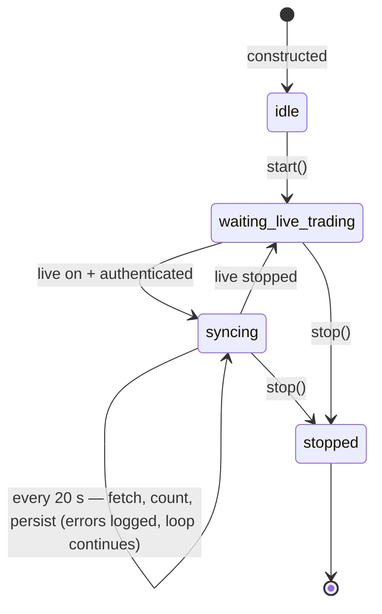

# TrackerAgent

`src/agent/tracker_agent.py` · one instance per logged-in Zerodha user · owned by `TradingServiceAgent` ([supervisor.py](../../src/agent/supervisor.py))

## Role

Every 20 s while live trading is on, fetches the user's positions and orders from Zerodha. It counts how many are open and saves a copy of both to the local SQLite store.

It is read-only: it never places, modifies or cancels orders. Its docstring calls this "reconciliation", but it doesn't compare anything (see T2).

## Configuration

| Setting | Value | Where |
|---|---|---|
| Interval | 20 s | `DEFAULT_POLL_INTERVAL_SECONDS` |
| Timeout per sync | 15 s | `SYNC_TIMEOUT_SECONDS` |
| Runs when | `service.is_running and service.is_authenticated` | `_run_loop` |
| Broker calls per sync | 2 (positions + orders, in parallel) | `asyncio.gather` |

## Lifecycle and states

Unlike the other agents, it has no "between cycles" state: it shows `syncing` the whole time live trading is on.

## State it keeps

| Field | Meaning | Caveat |
|---|---|---|
| `open_positions_count` | net positions with quantity ≠ 0 | |
| `open_orders_count` | orders in `OPEN` / `TRIGGER PENDING` | |
| `last_synced_at` | see caveat | updated after a success **or a timeout**, but not after a fetch error, so it means neither "last success" nor "last attempt" |
| `last_error` | last failure text | |

Exposed at `GET /api/agents/status` → `tracker`. **Not shown in the dashboard.** The counts aren't used by anything else in the app.

## Information flow

| Direction | What | How |
|---|---|---|
| reads | `service.is_running`, `service.is_authenticated` | gate |
| → Kite | `get_positions()` + `get_orders()` | through the public service methods |
| writes | `positions_log` and `orders_log` tables in `data/market_data.db` | via private `service._market_store`, best-effort |
| consumed by | nobody | counts sit in memory; tables aren't read by any screen or agent |

Meanwhile, when live trading starts, `TradingService.start_live` already launches:

- `_position_update_loop`: positions every 30 s, feeding the `RiskManager` (exposure, daily P&L, kill-switch threshold);
- `ExecutionEngine.start_reconciliation_loop`: a 2 s fast loop and 30 s slow loop that reconcile the engine's orders with the broker.

The Tracker is a **third** broker poller that runs alongside these two.

## Observed behaviour (logs and database)

**Logs, 7 Aug – 16 Oct 2026:** 98 sync failures and 20 timeouts.

| Count | Error |
|---|---|
| 88 | `validation error for Order — guid: Input should be a valid string (None)` |
| 10 | network, cannot connect to api.kite.trade |

The `guid` crash has been fixed since: models now map broker `null`s to defaults, and the last occurrence was 3 Sep.

**Database:**
- `positions_log` holds **1,332 rows for just 3 positions**, all written between **15:34 and 19:11** on 3 Sep, i.e. after market close.
- `orders_log` holds 2,220 rows.
- Nothing is ever deleted.

## Critical analysis

### T1 — Duplicates two existing loops without feeding them (medium)

Positions are fetched by both `_position_update_loop` (30 s) and the Tracker (20 s). Orders are reconciled by `ExecutionEngine` (2 s and 30 s) and fetched again by the Tracker. That's 6 extra broker calls a minute per user that inform nothing: the Tracker's counts don't reach the risk manager, the execution engine or the UI.

**Fix:** either delete the Tracker, or make it the single source of position and order snapshots that the risk manager and dashboard subscribe to. Remove `_position_update_loop` if you go that way.

### T2 — Says "reconciliation", doesn't reconcile (high)

The valuable job a tracker could do is spot **drift** between what the bot thinks it holds (`ExecutionEngine` tracked positions, journal) and what the broker reports. Examples: a position closed manually in Kite, a partial fill, an order the bot never saw. Nothing here compares the two.

**Fix:** on each sync, diff broker net positions against the engine's tracked positions by symbol and quantity. Record any mismatch with a timestamp, and surface it (log + dashboard + Verifier finding).

### T3 — Unbounded, after-hours history (medium)

`positions_log` is keyed by timestamp, so each sync appends a row per position: about 1,125 rows per position per day while live, never pruned. The evidence shows it kept writing for 3½ hours after the close because live trading was left on.

**Fix:**
- Store only on change (quantity, average price or P&L moved), or downsample to one row a minute.
- Pause outside market hours.
- Add a retention policy (e.g. keep 30 days).

### T4 — Only watches while the bot is live (medium)

Positions and holdings the user takes manually in Kite aren't tracked unless **Start Live** is running. (The Overview gets its account numbers from its own `/api/status?full=true` call instead.)

**Fix:** if the Tracker becomes the snapshot source (T1), run it whenever the user is authenticated during market hours, not only when live.

### T5 — Inconsistent `last_synced_at` (low)

It's updated after a timeout but not after a fetch error, so the status can't tell a healthy tracker from a failing one.

**Fix:** separate `last_success_at` and `last_attempt_at`.

### T6 — Writes through a private attribute (low)

`service._market_store` is private.

**Fix:** expose a `persist_snapshot()` method on the service.

## Recommended order of work

1. **T1 decision:** single snapshot source vs. delete.
2. **T2:** drift detection, the reason to keep it.
3. **T3:** store on change, pause after hours, retention.
4. **T4:** track whenever authenticated.
