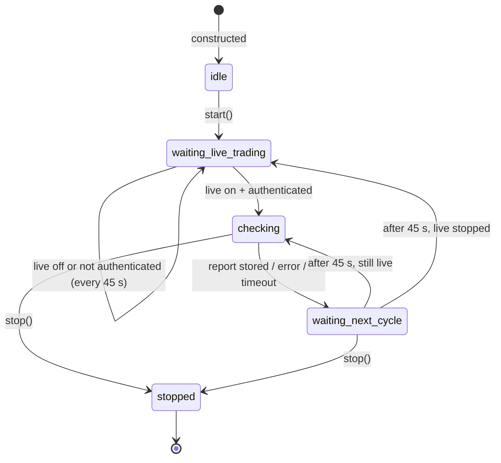

# VerifierAgent

`src/agent/verifier_agent.py` · one instance per logged-in Zerodha user · owned by `TradingServiceAgent` ([supervisor.py](../../src/agent/supervisor.py))

## Role

Runs the pre-trade checklist in `PreflightChecker` ([src/risk/preflight.py](../../src/risk/preflight.py)) every 45 s while live trading is on, and keeps the latest report for the dashboard.

It is **advisory only**: nothing in the order path consults it, so it can report "broker session dead" or "insufficient margin" while orders keep going out.

## Configuration

| Setting | Value | Where |
|---|---|---|
| Interval | 45 s | `DEFAULT_AUDIT_INTERVAL_SECONDS` |
| Timeout per audit | 20 s | `CHECK_TIMEOUT_SECONDS` |
| Mode | `TradingMode.LIVE`, `signal=None` | `_run_loop` |
| Runs when | `service.is_running and service.is_authenticated` | `_run_loop` |

## Lifecycle and states

`start()` builds one `PreflightChecker` from the service's private `_client`, `_ticker` and `_risk`. These are created once in `TradingService.__init__` and never replaced, so the references stay valid.

## State it keeps

| Field | Meaning | Caveat |
|---|---|---|
| `_state` | state above | |
| `last_report` | `PreflightReport.to_dict()` of the last *successful* audit | survives later timeouts and errors, so it can be stale |
| `last_checked_at` | time of the last successful audit | not updated on failure |
| — | no `last_error` | failures and timeouts only appear in the log |

Exposed at `GET /api/agents/status` → `verifier`. The dashboard's **Signals** tab shows `last_report.blocked_reasons` in a "Preflight found issues (advisory)" card (`loadVerifierFindings` in `dashboard.js`).

## Information flow

| Direction | What | How |
|---|---|---|
| reads | `service.is_running`, `service.is_authenticated` | gate |
| calls | `PreflightChecker.run_all_checks(signal=None, mode=LIVE)` | 15 live checks |
| → Kite | profile ping for "broker connected" (cached 60 s inside the checker); margins fetched **twice** per audit (sufficiency + utilisation checks) | REST via `service._client`, ~3–4 calls/min |
| reads | `service._ticker.is_connected`, risk manager state, clock | inside the checks |
| writes | `last_report` | in memory only |
| logs | `preflight_failed` (by the checker) **and** `verifier_agent_findings` (by the agent) | the same failure, twice |
| consumed by | Signals-tab card | polled by the browser |

It receives nothing from the Scanner and passes nothing to the Executor.

## Observed behaviour (logs, 7 Aug – 16 Oct 2026)

**1,437 `verifier_agent_findings` events.** The most common reasons:

| Count | Reason |
|---|---|
| 98 | WebSocket disconnected — live prices unavailable |
| 9 per minute-stamp, many stamps | `Market closed (16:43) — orders blocked`, `(16:46)`, `(16:50)` … |
| 20 | **Insufficient margin: ₹-88 < ₹0 needed** |
| 9 | Broker session dead: cannot connect to api.kite.trade |

There were also 4 audit timeouts.

## Critical analysis

### V1 — Findings never stop anything (high, design)

Orders flow `_on_ticks → strategy → ExecutionEngine.execute_signal` without consulting the Verifier. The docstring says making it a hard gate is "a separate, explicit decision". Until then, a dead broker session, a disconnected feed or negative margin produce a log line and a card on a tab the user may not be looking at.

**Fix:** decide which checks must block (broker dead, ticker down, kill switch, margin below zero). Have `ExecutionEngine` read a cached "trading allowed" flag the Verifier maintains, rather than re-running checks per order.

### V2 — Never checks an actual trade (medium)

With `signal=None`, `_check_signal_sanity` returns "No single signal (multi-leg mode)" and passes. Every check that needs a signal (price sanity, slippage, stop-loss present, exposure for this order) passes trivially. What runs is an **account health check**, not trade verification.

**Fix:** keep the periodic account audit, but run the signal checks on real signals, either at signal time or by auditing the last N signals from the signal log.

### V3 — Noise buries the real finding (medium)

There's no de-duplication or change detection. The same reasons are logged every 45 s for as long as they hold, and twice each (V-flow table). The market-closed message embeds the time, so even identical conditions never compare equal. In the evidence, 20 genuine **negative-margin** warnings sit among 1,400+ repeats. The agent also keeps auditing after 15:30 whenever live trading is left on.

**Fix:**
- Log only when the set of failing check *names* changes (compare names, not messages).
- Drop the agent's duplicate log line.
- Pause outside market hours.

### V4 — Stale report shown as current (medium)

A timeout or error leaves the previous `last_report` in place, and the UI renders it with its old timestamp and no warning. If the broker went down *after* the last good audit, the card can still say "All preflight checks passed".

**Fix:** record `last_error` and `last_attempt_at`, and have the UI flag reports older than ~2 intervals.

### V5 — Unescaped broker text in the UI (low, security)

`loadVerifierFindings` inserts `blocked_reasons` into `innerHTML` without escaping. Reasons include raw exception text from the network layer.

**Fix:** escape them (the page already has `escHtml`).

### V6 — Reaches into private service attributes (low)

`service._client`, `_ticker` and `_risk` are private. If `TradingService` ever rebuilds them (e.g. a ticker reconnect that creates a new instance), the checker silently keeps the old ones.

**Fix:** give `TradingService` a small public accessor, or build the checker on demand.

## Recommended order of work

1. **V3:** de-duplicate and pause after hours, so the card becomes trustworthy.
2. **V4:** show staleness.
3. **V1:** make a minimal set of checks blocking.
4. **V2:** verify real signals.
